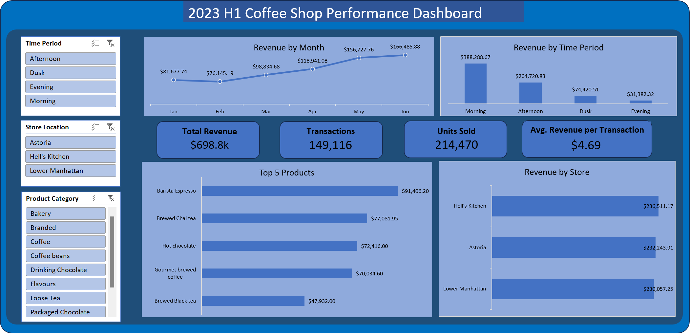

# Coffee Shop Sales Analysis

## Project Overview

This project analyzes six months of coffee shop transaction data from January through June 2023.

The goal was to evaluate overall sales performance, compare store locations, identify peak sales periods, understand product performance, and create an interactive Excel dashboard for business users.

## Business Questions

The analysis focused on the following questions:

- How much revenue did the business generate?
- How many transactions and units were recorded?
- How did revenue change from January to June?
- Which store generated the most revenue?
- Which time period generated the most sales?
- Which products and product categories performed best?

## Tools Used

- Microsoft Excel
- Excel Tables
- PivotTables
- PivotCharts
- Slicers
- Excel formulas

## Data Preparation

Before analysis, I reviewed the dataset for:

- Missing values
- Duplicate transaction IDs
- Correct data types
- Revenue calculation
- Time-period classification

Revenue was calculated using:

`Revenue = Transaction Quantity × Unit Price`

Transactions were also grouped into Morning, Afternoon, Dusk, and Evening periods for time-based analysis.

## Key KPIs

- **Total Revenue:** $698.8K
- **Transactions:** 149,116
- **Units Sold:** 214,470
- **Average Revenue per Transaction:** $4.69

## Key Findings

1. **Revenue increased strongly during the six-month period.**  
   Revenue reached its highest level in June at approximately $166.5K.

2. **Store performance was highly balanced.**  
   Hell's Kitchen generated the most revenue, but all three store locations contributed roughly one-third of total revenue.

3. **Morning was the strongest sales period.**  
   Morning transactions generated approximately $388.3K, accounting for more than half of total revenue.

4. **Coffee was the strongest product category.**  
   Coffee generated the highest category revenue, followed by Tea.

5. **Barista Espresso was the highest-revenue product.**  
   It generated approximately $91.4K during the analyzed period.

## Dashboard

The dashboard includes interactive filters for:

- Time Period
- Store Location
- Product Category

## Business Considerations

The strong concentration of revenue during morning hours suggests that management should review whether staffing and inventory levels are aligned with peak demand.

Revenue also increased substantially during the later months of the dataset. Additional historical data would be needed before determining whether this represents recurring seasonality.

## Project Files

- `Coffee_Shop_Sales_Analysis.xlsx` — Excel analysis and interactive dashboard
- `images/coffee_shop_dashboard.png` — Dashboard preview

## Skills Demonstrated

- Data validation and preparation
- KPI development
- PivotTable analysis
- Interactive dashboard creation
- Data visualization
- Business insight communication
